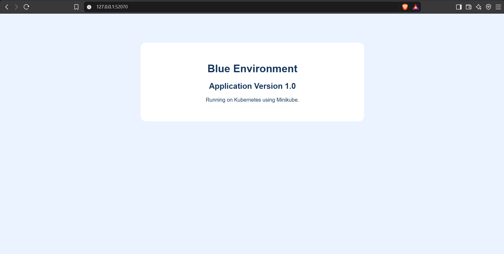
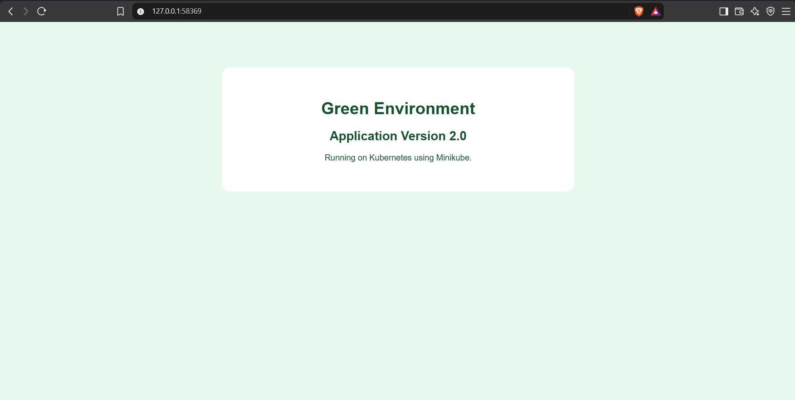
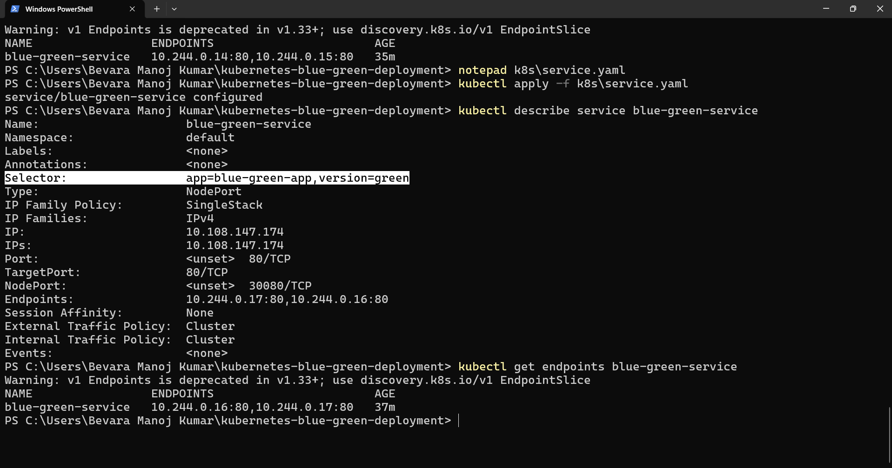
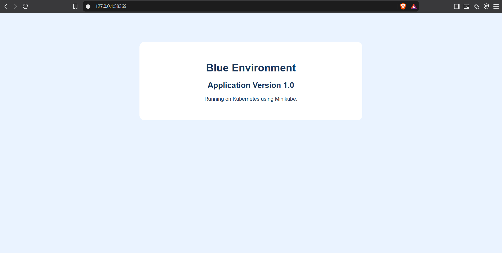
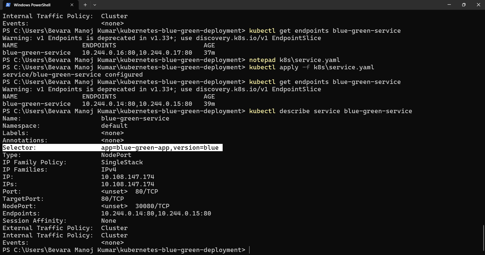

# 🚀 Kubernetes Blue-Green Deployment

### Zero-Downtime Deployment Strategy Using Docker, Kubernetes & Minikube

A hands-on DevOps project demonstrating the **Blue-Green Deployment strategy** using Docker containers and Kubernetes. Two application versions run in separate environments, and a Kubernetes Service controls which version receives traffic.

The project demonstrates application deployment, traffic switching, and rollback using a local Kubernetes cluster.

---

## 📌 Project Overview

Blue-Green Deployment is a release strategy that maintains two application environments:

- 🔵 **Blue Environment:** Current application — Version 1.0
- 🟢 **Green Environment:** New application — Version 2.0

Both versions are deployed independently in Kubernetes. Traffic is directed to the selected environment using a Kubernetes Service selector.

When the new version is ready, traffic can be switched from Blue to Green. If rollback is required, traffic can be redirected to Blue.

**Deployment environment:** Local Kubernetes cluster using Minikube.

---

## 🏗️ Architecture

```text
                       User / Browser
                              |
                              v
                    Kubernetes Service
                       NodePort: 30080
                              |
                   Service Label Selector
                              |
                +-------------+-------------+
                |                           |
                v                           v
          Blue Environment            Green Environment
          Version 1.0                 Version 2.0
                |                           |
          2 Application Pods          2 Application Pods
                |                           |
                +-------------+-------------+
                              |
                       Minikube Cluster
```

The Service selector determines which environment receives application traffic.

- `version: blue` routes traffic to Blue Pods.
- `version: green` routes traffic to Green Pods.

---

## 🛠️ Technologies Used

| Technology | Purpose |
|---|---|
| Docker | Containerizing the application |
| Kubernetes | Managing application deployments and Pods |
| Minikube | Running Kubernetes locally |
| kubectl | Managing Kubernetes resources |
| NGINX | Serving the application pages |
| YAML | Defining Kubernetes resources |
| HTML & CSS | Creating the application pages |
| PowerShell | Executing deployment commands on Windows |

---

## 📂 Project Structure

```text
kubernetes-blue-green-deployment/
│
├── app/
│   ├── blue/
│   │   ├── Dockerfile
│   │   └── index.html
│   │
│   ├── green/
│   │   ├── Dockerfile
│   │   └── index.html
│   │
│   └── Dockerfile
│
├── k8s/
│   ├── blue-deployment.yaml
│   ├── green-deployment.yaml
│   └── service.yaml
│
├── screenshots/
│
├── .gitignore
└── README.md
```

---

## ⚙️ Deployment Workflow

### Step 1: Start Minikube

Start the local Kubernetes cluster using Docker as the driver.

```powershell
minikube start --driver=docker
```

Verify the cluster:

```powershell
kubectl get nodes
```

### Step 2: Build Docker Images

Build the Blue and Green application images.

```powershell
docker build -t blue-green-app:1.0 ./app/blue
docker build -t blue-green-app:2.0 ./app/green
```

### Step 3: Load Images into Minikube

Make the locally built images available to the Kubernetes cluster.

```powershell
minikube image load blue-green-app:1.0
minikube image load blue-green-app:2.0
```

### Step 4: Deploy Both Environments

Create the Blue and Green Kubernetes Deployments.

```powershell
kubectl apply -f k8s/blue-deployment.yaml
kubectl apply -f k8s/green-deployment.yaml
```

Verify the deployments and Pods.

```powershell
kubectl get deployments
kubectl get pods --show-labels
```

### Step 5: Create the Kubernetes Service

Apply the Service configuration.

```powershell
kubectl apply -f k8s/service.yaml
```

The Service uses NodePort `30080` and selects the application Pods using their labels.

### Step 6: Access the Application

Run:

```powershell
minikube service blue-green-service --url
```

Open the URL returned by Minikube in your browser.

---

## 🔄 Blue-Green Traffic Switching

The Kubernetes Service controls which environment receives traffic.

### Blue Environment — Version 1.0

The Service selector for Blue is:

```yaml
selector:
  app: blue-green-app
  version: blue
```

When this selector is active, requests are routed to the Blue application Pods.

### Switch to Green — Version 2.0

Update `k8s/service.yaml` to use:

```yaml
selector:
  app: blue-green-app
  version: green
```

Apply the updated configuration:

```powershell
kubectl apply -f k8s/service.yaml
```

Verify the Service selector and endpoints:

```powershell
kubectl describe service blue-green-service
kubectl get endpoints blue-green-service
```

Refresh the application page to verify that the Green application is served.

---

## ↩️ Rollback to Blue

If the new application version needs to be rolled back, update the Service selector in `k8s/service.yaml`:

```yaml
selector:
  app: blue-green-app
  version: blue
```

Apply the configuration:

```powershell
kubectl apply -f k8s/service.yaml
```

Verify the active selector:

```powershell
kubectl describe service blue-green-service
```

Refresh the browser to confirm that **Blue Environment — Version 1.0** is served again.

This demonstrates how traffic can be redirected to the previous application version without deleting the Green Deployment.

---

## ## ## 📸 Project Screenshots

### 1. Blue Environment — Version 1.0
The application running in the Blue environment before switching traffic.



### 2. Green Environment — Version 2.0
The updated application running in the Green environment, ready to receive traffic.



### 3. Traffic Switch to Green
The Kubernetes Service selector updated to route traffic to the Green environment.



### 4. Rollback to Blue
Traffic switched back to the Blue environment to demonstrate the rollback capability.



### 5. Verify Blue Service Selector
The Kubernetes Service selector updated back to Blue, confirming the rollback configuration.


---

## 🎯 Key Learnings

- Containerizing applications with Docker.
- Deploying multiple application versions using Kubernetes.
- Managing Deployments and Pods.
- Configuring Kubernetes Services, labels, and selectors.
- Switching traffic between Blue and Green environments.
- Performing rollback by updating a Service selector.
- Running and troubleshooting a local Kubernetes cluster with Minikube.

---

## ✅ Project Outcome

Successfully demonstrated a local Blue-Green Deployment workflow with two application versions, Kubernetes-based traffic switching, and rollback to the previous version.

The project provides practical experience with containerization, Kubernetes resource management, and application release strategies.

---

## 👨‍💻 Author

**Bevara Raghunadh**

This project was created as a hands-on learning project to practice Docker, Kubernetes, and deployment strategies.
